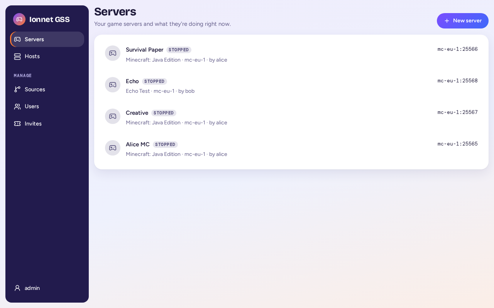
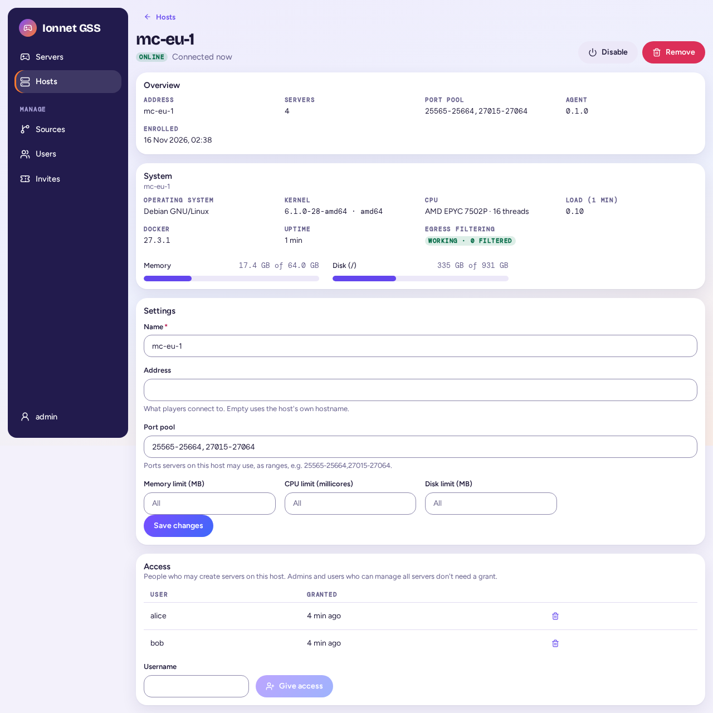
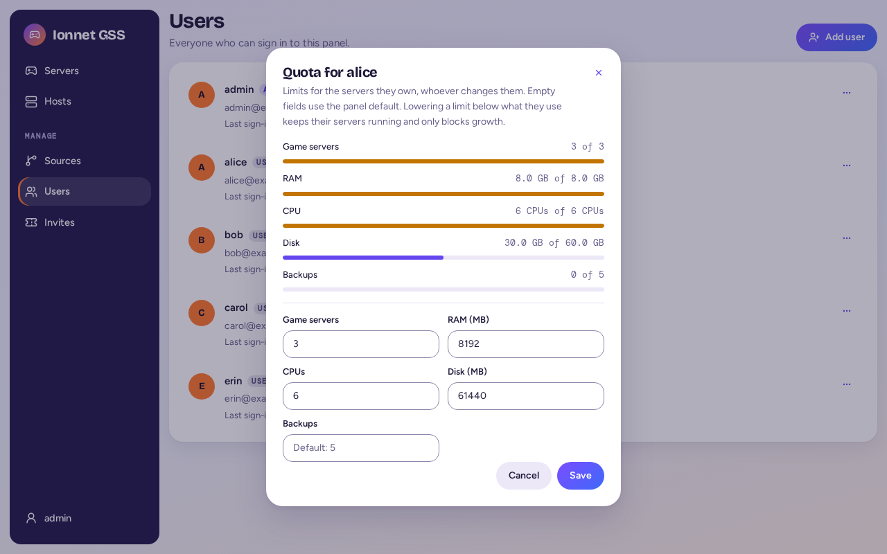

# Ionnet GSS

Run your friends' game servers (and your own) from one web page, on machines you already have. No SSH, no hand-written `docker run` lines, and nobody gets root.

Ionnet GSS is a game server manager for people who host servers for other people. One panel, any number of host machines, one container per game server. Each person gets their own quota, and only what you grant them.



<sup>Everyone's servers on one page. Players only see the ones they own or were given.</sup>

## Key Features

- **One panel, many hosts**: install a small agent on any Linux machine with one command. The agent dials out to the panel, so the host needs no open inbound port for the panel.
- **Games are folders**: a game is a `game.yml` (plus hooks and config templates) in a git repository. Minecraft Java and Garry's Mod come with the panel; add your own repository as a source and its games show up in the create form.
- **Safe upgrades**: a server keeps the definition it was created with. When the repository changes, the server shows "Update available" and you apply it when it suits you.
- **Real consoles and files**: live console with input, a file manager with uploads and downloads, backups and restores, CPU and memory graphs, and a player list where the game supports it.
- **Quotas per person**: servers, RAM, CPU, disk and backups, with panel-wide defaults. Admins are exempt.
- **Hosts are granted, not shared by default**: a user can only create servers on hosts you grant them.
- **Sharing**: give another user view, operate or manage access to a single server.
- **Locked-down game containers**: no capabilities, resource limits, and no outbound access to private networks or the host by default.
- **Two-factor sign-in**: authenticator app codes with recovery codes, and an admin reset for people who lose their phone.
- **Invites**: add people with a link that expires, with the role you pick.



<sup>A host: facts from the agent, port pool, capacity limits and who may create servers on it.</sup>



<sup>Quotas show what a user has used next to what they may use. Empty fields use the panel defaults.</sup>

## Documentation

For admins:

- [Install the panel](docs/admin/install-panel.md): Docker Compose or from source, settings, first admin, HTTPS.
- [Add a host](docs/admin/add-host.md): the install one-liner, what it does, ports, capacity, the outbound block, troubleshooting.
- [Game sources](docs/admin/game-sources.md): add a git repository of games, pinning and upgrades.
- [Users and quotas](docs/admin/users-and-quotas.md): invites, permissions, quotas, host grants, sharing, two-factor.

Writing games: the [ionnet-gss-games](https://github.com/ionnet-dev/ionnet-gss-games) README (the `games` submodule; clone with `--recurse-submodules`). Design notes and the build plan: [STRUCTURE.md](STRUCTURE.md) and [docs/blueprint.html](docs/blueprint.html).

## Current limits

- The game images (`ionnet-gss-base`, `ionnet-gss-minecraft-server`) are only built locally so far with `deno task images:build`. They are not published to a registry yet, so a host needs them built on it, or loaded into its Docker, before the first server can start there. See [Add a host](docs/admin/add-host.md#game-images).
- The install script was proven on Debian 12 and Arch Linux. Ubuntu is expected to work (it takes the Debian path) but was not tried.
- Disk limits are soft: they are checked when a server starts and about once a minute while it runs, not enforced by the filesystem.

## Technical

The panel is a Deno + Hono + Sequelize (MariaDB) service with a React web app. Each host runs `gss-agent` (Go), which talks to the panel over a WebSocket and drives Docker. Inside each game container a small supervisor, `gss-init`, installs and runs the game.

```
browser ──► panel (Deno, Hono, MariaDB) ◄── WebSocket ── gss-agent (Go, one per host) ──► Docker
                                                          └─ gss-init in every game container
```

Development needs Deno 2, Node 22 (for the web app), Go 1.27 (for the agent) and Docker (for MariaDB and the game containers).

```sh
deno task db:up                  # MariaDB on 127.0.0.1:3308
cd client && npm install && cd ..
cp .env.example .env
deno task dev                    # panel on http://localhost:3200, web app proxied from Vite
deno task migrate up             # also runs at startup (AUTO_MIGRATE)
deno task check                  # type checks, protocol check, lint, client tsc
deno task check:agent            # go build + go vet
cd agent && make build           # agent/bin/gss-agent and gss-init
deno task images:build           # local game images
```

`STRUCTURE.md` has the file tree, the API routes and where new code goes. `CLAUDE.md` has the conventions.
