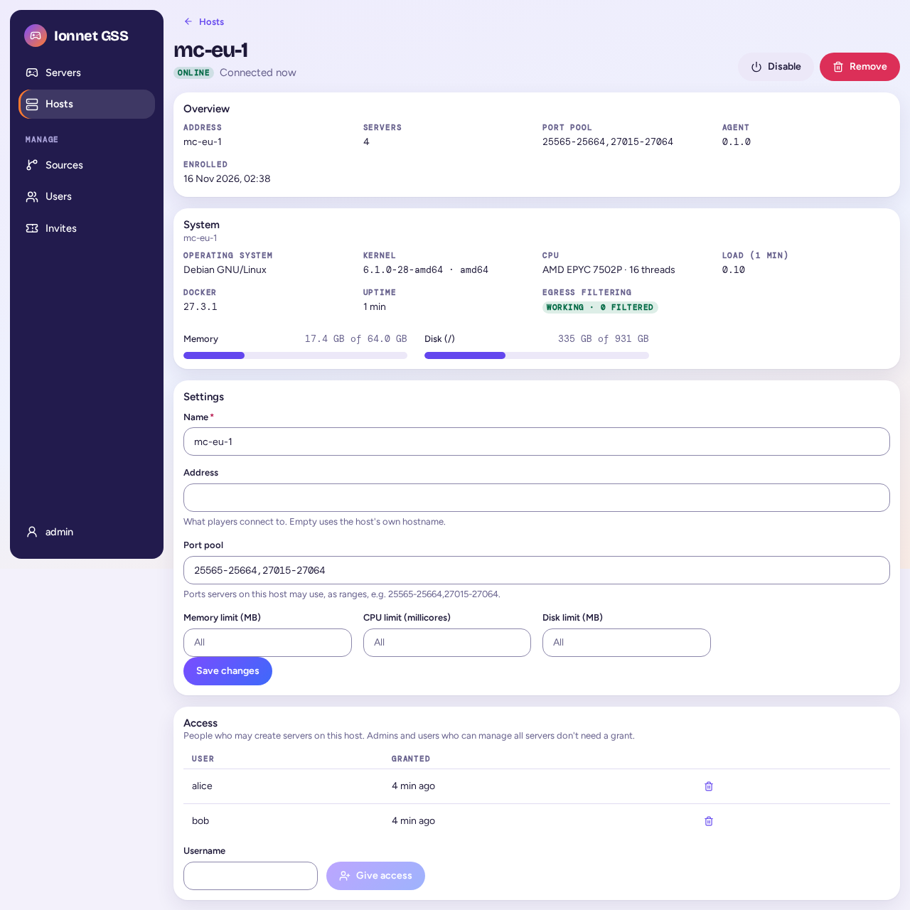

# Add a host

A host is a Linux machine that runs game servers. It runs the agent, `gss-agent`, as a systemd service. The agent connects out to the panel and keeps that WebSocket open, so the host needs no inbound port for the panel. Game ports are another matter: players connect to those, so open them (see [Ports](#ports-and-capacity)).



## Requirements

- Linux with systemd, on Arch Linux or Debian/Ubuntu (the script looks for `/etc/arch-release` or `/etc/debian_version`). Anything else stops with exit 3.
- `x86_64` or `arm64`.
- root, through `sudo`.
- `curl`. The script installs the rest.
- A working route to the panel, preferably over HTTPS (see [HTTPS](install-panel.md#https)).
- A data disk that is a real disk. Files on tmpfs count against the container's memory, so installs get killed. The agent warns about this when it starts.

The script installs Docker (`docker` on Arch, `docker.io` on Debian/Ubuntu) and the `nftables` package if they are missing. It was proven on Debian 12 and Arch Linux. It was not tried on Ubuntu; Ubuntu takes the Debian path.

The panel must have the agent builds in its `AGENT_DIST_DIR` (the Docker image has them; from source run `make dist` in `agent/`). Check with:

```sh
curl -s https://gss.example.com/api/agent/download/linux/amd64/sha256
```

It prints a hex digest. A 404 "The panel has no agent build for linux/amd64" means the build is missing.

## The Add host flow

The button is called **Enrol a host** on the Hosts page. It needs the `HOSTS_MANAGE` permission, which admins have.

1. Open **Hosts** and click **Enrol a host**.
2. Optionally name the host (empty uses the machine's hostname) and pick how long the command works: 15 minutes, 1 hour or 24 hours.
3. Click **Create command**. The dialog shows the install command, the enrol token with its own copy button and, below them, a manual enrol command. The token is shown once. Only its hash is stored.
4. Run the install command on the host:

```sh
curl -fsSL https://gss.example.com/api/agent/install.sh | sudo bash
```

5. The script asks `Enrol token:`. Paste the token from the dialog. It isn't echoed, and it never appears on a command line, in the process list or in the shell history.

For unattended installs, set `GSS_ENROL_TOKEN` in the environment instead (for example `export` it from a secrets file, then `sudo -E bash`). Don't write it on the command line. Without the variable and without a terminal the script exits with code 2.

If the panel is on plain `http://`, the dialog and the script both warn that the script and the agent download can be altered on the way. Only do that on a trusted network. The host appears on the Hosts page as soon as the agent connects, with its CPU, memory, disk, Docker version and egress status.

Enrol tokens work once. A token that is unused, expired or revoked shows under "Waiting to be used" on the Hosts page, where you can revoke it.

### Enrolling by hand

If `gss-agent` is already on the machine (for example you built it with `make build`), use the second command from the dialog instead:

```sh
sudo gss-agent enrol --panel https://gss.example.com --token-stdin
sudo systemctl enable --now gss-agent
```

`enrol` waits for input: paste the token and press Enter.

`enrol` also takes `--token <TOKEN>` (visible in the process list, so prefer stdin), the `GSS_ENROL_TOKEN` variable, `--config <PATH>` (default `/etc/ionnet-gss/agent.json`), `--insecure` and `--force` (replace an existing enrolment). Without a systemd unit, start the agent with `gss-agent run`.

## What the install script does

In order:

1. Checks it runs as root, that the system is Arch or Debian/Ubuntu with systemd, and that `curl` exists.
2. Picks the build from `uname -m`: `amd64` or `arm64`.
3. Refreshes the apt package lists on Debian/Ubuntu (it never runs a partial upgrade on Arch).
4. Installs Docker if `docker` is missing, then enables and starts the docker service.
5. Installs `nftables` if `nft` is missing, but **never enables its service**. Debian's `/etc/nftables.conf` begins with `flush ruleset`, which would wipe Docker's rules and the agent's. If the package enabled the service on install, the script turns it off again.
6. Downloads the agent to `/usr/local/bin/gss-agent.new`, checks it against the panel's checksum, then renames it to `/usr/local/bin/gss-agent`. A mismatch deletes the download and stops with exit 1.
7. Enrols with the token, unless `/etc/ionnet-gss/agent.json` exists. In that case it only upgrades.
8. Writes `/etc/systemd/system/gss-agent.service`, reloads systemd and runs `systemctl enable --now gss-agent` (a restart when the service already runs).

It finishes with "Done! gss-agent is running. The host shows up on the panel's Hosts page as soon as it connects."

Files it leaves on the host:

| Path | What |
| --- | --- |
| `/usr/local/bin/gss-agent` | The agent. |
| `/etc/systemd/system/gss-agent.service` | The unit. `Restart=always`, except exit code 3 (see [Troubleshooting](#troubleshooting)). |
| `/etc/ionnet-gss/agent.json` | The host's credential. Keep it private. |
| `/var/lib/ionnet-gss/` | Game server data, spec files, backups. |

### Flags and exit codes

Flags go after `bash -s --` when you pipe:

```sh
curl -fsSL https://gss.example.com/api/agent/install.sh | sudo bash -s -- --no-start
```

| Flag | Effect |
| --- | --- |
| `--panel <URL>` | Use another panel address than the one the script came from. |
| `--insecure` | Allow a plain `http://` panel on another machine. The panel sets this itself when its `PUBLIC_URL` is plain http on a non-loopback host. |
| `--no-start` | Enable the service but don't start it. |
| `--dry-run` | Print each step instead of changing the system. The download is still checked. |
| `-y`, `--yes` | Ask no questions. |

Commands: `install` (the default), `uninstall`, `help [command]` and `version`.

| Exit code | Meaning |
| --- | --- |
| 0 | Done. |
| 1 | A step failed (not root, download or checksum failure, enrol rejected, Docker or the service wouldn't start), or you answered no to the purge question. |
| 2 | Bad arguments, an unknown option, no panel address, or, on a first install, no `GSS_ENROL_TOKEN` and no terminal to ask for the token on. |
| 3 | Unsupported system: not Arch or Debian/Ubuntu, no systemd, or an architecture other than `x86_64` and `arm64`. |

## Upgrade and re-run

Running the script again is safe. On an enrolled host it skips enrolling, replaces the binary and restarts the service. No token is needed:

```sh
curl -fsSL https://gss.example.com/api/agent/install.sh | sudo bash
```

The script downloads the agent from the panel, so an agent upgrade is: upgrade the panel (its image carries the newer build), then run this on each host. Running game containers keep running while the agent restarts.

## Uninstall

```sh
curl -fsSL https://gss.example.com/api/agent/install.sh | sudo bash -s -- uninstall
```

This stops and removes the service and the binary and keeps `/etc/ionnet-gss` and `/var/lib/ionnet-gss`. Add `--purge` to delete those two as well. That deletes the host's credential and **every game server's data on the host**, so it asks `[y/N]` first (`-y` skips the question; with no terminal the answer is no). Game server containers are not removed either way. Find them with `docker ps -a` (they are called `gss-<server id>`).

Then remove the host in the panel (**Host page → Remove**). That is refused while game servers still exist on it, so delete them first. Removing the host also ends the agent's connection and makes its credential useless.

## Game images

The game definitions refer to images such as `ionnet-gss-base` and `ionnet-gss-minecraft-server`, which hosts pull from `IMAGE_REGISTRY` (default `ghcr.io/ionnet-dev`). They are published there by CI, for linux/amd64:

| Image | Built from | Published by |
| --- | --- | --- |
| `ionnet-gss-base:latest` | `images/base/Dockerfile` in this repository (it compiles `gss-init` from `agent/`) | `.github/workflows/base-image.yml` |
| Game images, e.g. `ionnet-gss-minecraft-server:java21` | `<game>/image/` in [ionnet-gss-games](https://github.com/ionnet-dev/ionnet-gss-games) | that repository's `Images` workflow |

Both workflows rebuild an image only when what it is built from changed: its Dockerfile and files (for the base, the Go files `gss-init` is compiled from, not the rest of the agent), its build args, or the exact upstream image behind a `FROM` line (`debian:trixie-slim`, `eclipse-temurin:21-jre`, the base for the game images). They check on pushes, daily (the base at 03:47 UTC, the game images at 04:17 UTC, so a new base reaches the game images the same day) and on demand (**Run workflow**, with **force** to build anyway). Each image records its inputs as `dev.ionnet.gss.inputs*` labels, and the run summary says per image whether it was skipped or what changed.

A host pulls an image the first time a server needs it, and again whenever a server installs or reinstalls, so a rebuilt image reaches a server at its next (re)install. Running servers keep their image until then. If the registry can't be reached, a host that already has the image uses its copy.

The base image matters on every host even without a game that uses it directly, because the agent also uses it for the short-lived container that applies the firewall rules.

To test an image change before publishing it, build it locally (needs a checkout of this repository with the `games` submodule):

```sh
deno task images:build            # base and every game image; or: bash images/build.sh
bash images/build.sh base         # only ionnet-gss-base
bash images/build.sh games minecraft-java
```

Then load it on a test host (`docker save <image> | ssh host docker load`). The next install there pulls from the registry again, so a local-only image is replaced if the registry has the same tag.

## Ports and capacity

**Port pool.** A host has a port pool, a list of ports and ranges such as `25565-25664,27015-27064`. New hosts get `DEFAULT_PORT_POOL`. The panel gives each server the ports its game asks for from this pool, the game's default first, and skips ports that something else on the host already listens on. Edit the pool on the host page (**Settings → Port pool**). A bad value is refused with a message like `"abc" is not a port or a range. Use e.g. "25565-25664,27015".` Users with the `PORTS_OVERRIDE` permission can pick ports outside the automatic allocation.

The install script does not touch your firewall. Open the pool yourself (ufw, firewalld, nftables or your cloud provider's security group). TCP and UDP follow the game: Minecraft is TCP, Garry's Mod is UDP.

**Address.** The address players connect to defaults to the host's own hostname. Set **Address** on the host page to a public name or IP.

**Capacity.** The panel refuses to place a server when the sums on the host would pass its capacity. Unless you set limits, capacity is derived from what the agent reports:

| Resource | Default capacity |
| --- | --- |
| Memory | total RAM minus 1024 MB kept for the host itself |
| CPU | 1000 millicores per hardware thread |
| Disk | the size of the data disk |

Set **Memory limit (MB)**, **CPU limit (millicores)** or **Disk limit (MB)** on the host page to use less. Empty means the default above. A refusal reads: `mc-eu-1 doesn't have enough memory left: this server needs 32768 MB, 7680 of 16384 MB are free.` The sums count each server's limits (and its stack services' limits), not what it uses right now. Disk is the soft limit; see [Users and quotas](users-and-quotas.md#quotas).

Capacity is per host. It is separate from the user's [quota](users-and-quotas.md#quotas): a request has to fit both.

## Outbound traffic from game servers

By default a game server can reach the public internet and nothing else. Its container cannot open connections to:

- private and special-use ranges: `10.0.0.0/8`, `172.16.0.0/12`, `192.168.0.0/16`, `100.64.0.0/10`, `127.0.0.0/8`, `169.254.0.0/16` (link-local), multicast and reserved ranges, and the IPv6 equivalents (`fc00::/7`, `fe80::/10`, `::1` and the tunnelling forms of private IPv4 addresses),
- the host itself: its bridge gateway, its LAN or public address and its local services.

A blocked connection fails at once ("No route to host"). Only destinations are filtered, replies to players are not. A server and the services in its own stack (for example a database) can still talk to each other.

The agent does this with its own nftables table, `inet ionnet_gss`. It never reads or changes Docker's tables or yours. The host page shows **Egress filtering: WORKING** with the number of filtered servers. If filtering cannot be applied, servers that should be restricted do not start (409 with the reason) until it works, and the page shows a warning.

An admin can switch this off for one server: the **Allow access to private networks** switch in the create form and in the server's settings. Only people with the `SERVERS_PRIVATE_NETWORK` permission (admins) can change it, it can only change while the server is stopped, and it is audited. Use it for a server that has to reach a database on your LAN.

Limits worth knowing: a neighbour on a public address (another VM in the same datacenter) is reachable like any internet host. Restarting `nftables.service` with a `flush ruleset` config removes the agent's table; the agent notices within about a minute and rebuilds it.

## Letting users create servers on a host

Admins can create servers on any host. A regular user can create servers only on hosts they were **granted**, and only within their quota. On the host page, under **Access**, enter a username and click **Give access**. The host then shows up in that user's create form. Revoking a grant only stops new servers: their existing servers on that host keep running and stay theirs to operate.

See [Users and quotas](users-and-quotas.md#host-grants).

## Troubleshooting

| Symptom | What to check |
| --- | --- |
| The script says "Run this as root" or "Only Arch Linux and Debian/Ubuntu with systemd are supported" | Use `sudo`. Other distributions are not supported (exit 3). |
| "No enrol token and no terminal to ask on…" | The script couldn't prompt for the token. Run it from an interactive shell, or set `GSS_ENROL_TOKEN` in the environment and keep it with `sudo -E`. |
| "The enrol token is unknown, already used or expired" | Tokens work once. Create a new command on the Hosts page. |
| "Download failed (HTTP 404): The panel has no agent build…" | The panel has no agent build for this architecture. See the requirements above. |
| "…doesn't match its checksum" | Nothing was replaced. Retry, and check any proxy between the host and the panel. |
| "refusing to send credentials over plain http://…" | `PUBLIC_URL` is plain http and the panel is on another machine. Use HTTPS, or `--insecure` on a trusted network. |
| Host shows **Offline** | The panel marks a host offline after 45 seconds without a heartbeat (`AGENT_OFFLINE_AFTER_SEC`). On the host run `systemctl status gss-agent` and `journalctl -u gss-agent -e`. Check that Docker runs and that the host can reach `PUBLIC_URL` (the proxy must pass WebSocket upgrades on `/ws/agent`). |
| The agent service is stopped and won't restart | Exit code 3 means the panel revoked this host (it was disabled or removed), and systemd does not restart on exit 3. If the host was only disabled, enable it again on its page and run `systemctl restart gss-agent`. If it was removed, enrol again with a new token: `gss-agent enrol --panel … --token-stdin --force`, then `systemctl restart gss-agent`. |
| A server won't start and mentions egress filtering | See the host page. The helper image (`ionnet-gss-base`) may be missing on the host, or `nft` can't load its kernel modules. |
| A server fails to start because the image can't be found | The game images aren't on that host. See [Game images](#game-images). |
| Installing a game gets killed | The data root is on tmpfs or a RAM disk. Put `/var/lib/ionnet-gss` on a real disk. |
