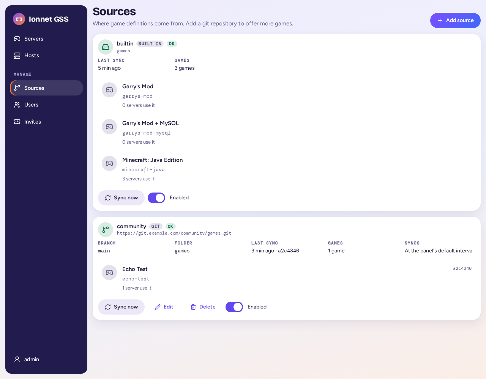

# Game sources

A game is a folder with a `game.yml` in it: variables, ports, install steps, how to start and stop it. A **source** is where the panel reads those folders from. The panel's create form offers the games of every enabled source.



There are two kinds:

- **git**: any git repository you can reach over https. A panel run from the Docker image adds the official one, [ionnet-gss-games](https://github.com/ionnet-dev/ionnet-gss-games), by itself at its first start (`OFFICIAL_SOURCE_URL`; set it empty to add none). It ships Minecraft: Java Edition, Garry's Mod and Garry's Mod + MySQL, and behaves like any source you add. If you delete it and have no other git source, it comes back at the next restart; switch it off instead.
- **builtin**: the `games/` folder of the panel's own checkout (`GAMES_DIR`), for a panel run from source. That folder is the official repository as a git submodule. The panel syncs it at startup. You can switch it off but not edit or delete it. The Docker image has no such folder, so it has no builtin source.

How to write a `game.yml` (variables, install steps, config formats, services, `options_from`) is in [games/README.md](https://github.com/ionnet-dev/ionnet-gss-games#format). The full schema is `protocol/schema/definition.json`. This page is about adding and running sources.

Managing sources needs the `SOURCES_MANAGE` permission, which admins have. Open **Manage → Sources**.

## Add a git source

Click **Add source** and fill in:

| Field | What it is |
| --- | --- |
| Name | Shown next to each game. Lowercase letters, digits and dashes, at most 63 characters. `builtin` is taken. |
| Repository address | An `https://` address, for example `https://github.com/you/games.git`. |
| Branch | Default `main`. |
| Folder | Where the game folders are in the repository. Empty means the top of the repository. Each game is a folder directly below it, with `game.yml` inside. |
| Access token | For a private repository. See below. |
| Sync every | Minutes between automatic syncs. Empty uses `SOURCE_SYNC_INTERVAL_MIN` (60). `0` means manual only. |

For a repository laid out like this:

```
games/
  echo-test/
    game.yml
    hooks/install.sh
```

use folder `games`. The panel syncs once when you add the source, and the games it finds appear on the source card. Run another sync any time with **Sync now**. It also syncs by itself on the interval.

The same thing through the API (the token is your own login token):

```sh
curl -X POST https://gss.example.com/api/sources \
  -H "Authorization: Bearer $TOKEN" -H "Content-Type: application/json" \
  -d '{"name":"community","url":"https://git.example.com/community/games.git","path":"games"}'
```

### Private repositories

Create a read-only access token for the repository on your git host (a personal access token on GitHub, a deploy or project token on GitLab) and paste it into **Access token**. The panel sends it as an HTTP Basic header (user `git`, the token as the password) and does not write it into the clone's git config, logs or error messages. It is write-only: the edit dialog says "A token is set" but never shows it again, and a checkbox removes it. If the repository refuses the request, the card says: "The repository refused the request. It is private or the token is wrong or lacks read access: set a token on the source."

If you change the address to a different host, the saved token is cleared. A token is never sent to a host it was not made for.

### What the panel accepts

The panel never runs anything from a repository. It reads the files straight out of the fetched commit. Because of that:

- Only `https://` works. `http://`, `ssh://`, `file://` and `git@host:path` are refused.
- A repository with submodules is refused.
- Symlinks, dotfiles, files over 1 MiB and files that are not UTF-8 text are skipped.
- A checkout over `SOURCE_MAX_MB` (50) or `SOURCE_MAX_FILES` (5000) is refused, and a clone or fetch that takes longer than `SOURCE_GIT_TIMEOUT_SEC` (60 seconds) is stopped. Game files are small: install steps download the heavy parts at install time.
- Hooks are never run on the panel's machine. They run in the game's container as part of an install.

A source on a server with a private CA certificate needs that CA set for the panel process (`GIT_SSL_CAINFO`). See [the CA note](install-panel.md#a-private-certificate-authority).

## When a sync goes wrong

Each game is checked on its own. If one game fails validation, the others in the source still update, and the failing game keeps its previous version. The reason shows on the source card. This is what a broken `game.yml` looked like in a test:

```
echo-test/game.yml: not valid YAML (Cannot read flow collection: unexpected end of the stream within a flow collection at line 19, column 1:).
```

Fix the file, push, and sync again. A failure to reach the repository shows as an error on the source and changes nothing.

## Pinning and upgrades

A server keeps the definition it was created with, even if the repository changes. Pushing a new commit never changes a running server.

After a sync that finds a changed `game.yml`, every server created from the older version shows **Update available** on its page, with the two commit hashes (for example `6f78b80 → 5874cca`). The owner (or someone with manage access) applies it with **Apply update**, while the server is stopped:

- The server's variables are kept. If the new version rejects a kept value or adds a required variable, the panel asks for just those values and names them (`"Label" (key)`).
- The server is provisioned again with the new definition. If the install steps or a `reinstall` variable changed, the install runs again.
- If provisioning fails, the panel puts the old definition back, on a best effort basis.
- The new version's limits are checked against the owner's [quota](users-and-quotas.md#quotas) and the host's [capacity](add-host.md#ports-and-capacity) first. A refusal leaves the server as it was.

The builtin source (panels run from source) is the exception: its definitions update in place when `games/` changes and the panel restarts (or on **Sync now**), so its servers don't show "Update available".

A different action, **Update game** in the server's menu, is for steamcmd games: it re-runs only the steamcmd steps (a new game version) while the server is stopped. It does not change the definition.

## Disable and delete

- **Switch off** (the toggle on the card): the source's games stop appearing in the create form. Existing servers keep running and keep their definition.
- **Delete** a git source: refused while any game server uses a definition from it (`1 game server uses definitions from this source. Delete them first, or switch the source off to stop offering its games.`). With no servers on it, deleting also removes the panel's clone.
- **Edit** changes the address, branch, folder, token and interval. The builtin source only has the on/off switch.
