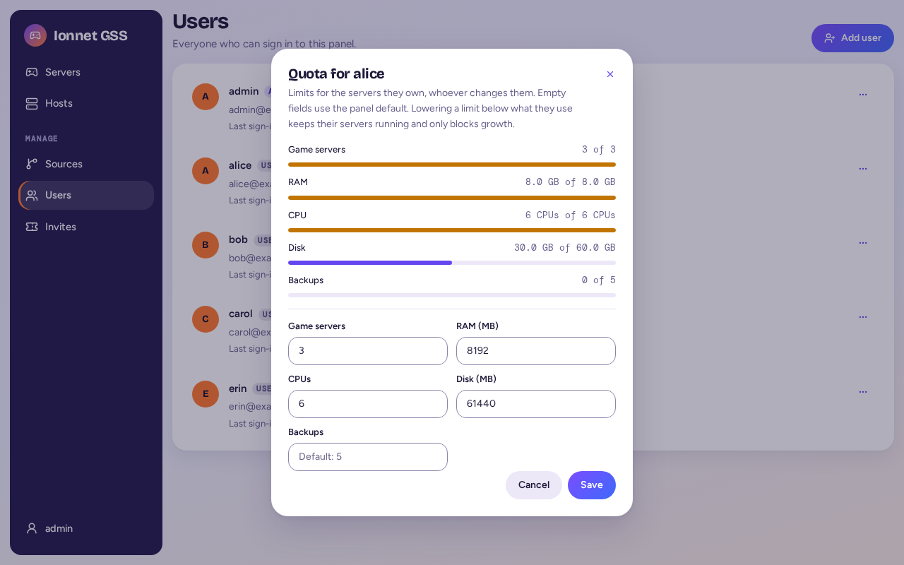
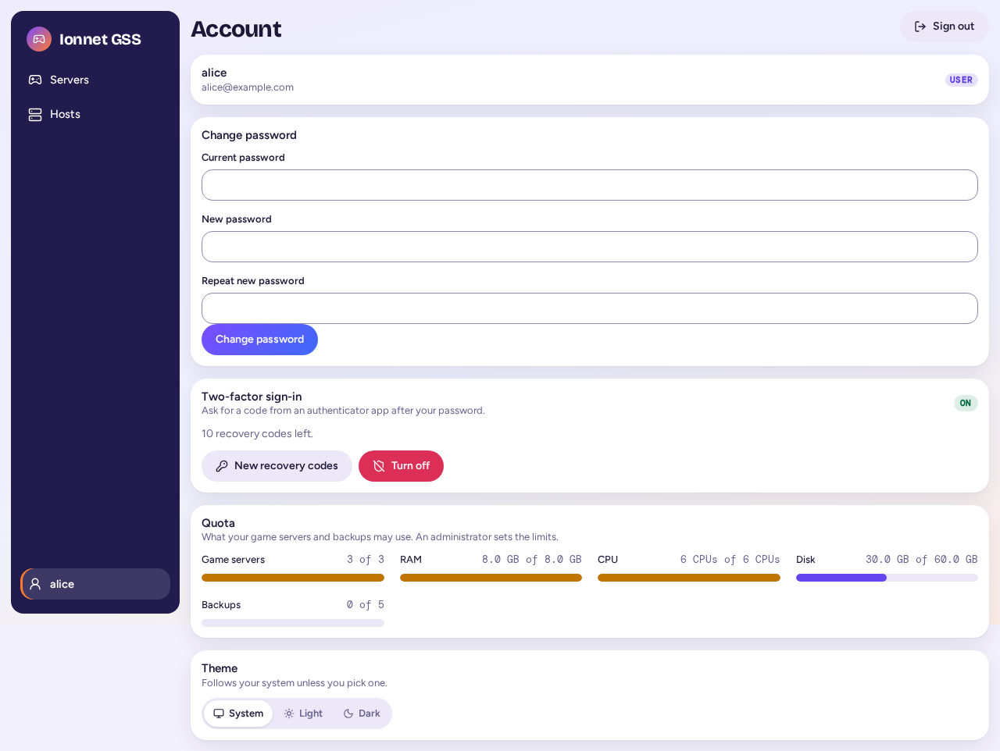

# Users and quotas

Who can sign in, what they may do, how much they may use, and who else may touch their servers.



## Add people

There are two ways in. Both need the permission for it (`USERS_MANAGE` or `INVITES_MANAGE`), which admins have.

### Invites

**Manage → Invites → Create invite.** Pick a role (`user` or `admin`), how long the link works (default 72 hours, `INVITE_TTL_HOURS`) and optionally an email. The panel shows the link once, for example:

```
https://gss.example.com/register?code=gss_inv_…
```

Send it to the person. They choose their own username and password (at least 10 characters). One invite makes one account, and it stops working after that or when it expires.

If you give an email, the invite is tied to it: registering with another address is refused ("This invite was issued for a different email address"). Without one, anyone with the link can use it. You can revoke an unused invite from the same page.

### Add the account yourself

**Manage → Users → Add user** creates an account with a password you choose. Share the password with them; they can change it under **Account**. From a user's menu you can also edit them, reset their password, disable them and delete them. Changing a password, a role or disabling an account signs that person out everywhere. The last admin cannot be deleted or demoted.

## Roles and permissions

There are two built-in roles. The panel has no screen for creating more.

| Role | What it is |
| --- | --- |
| `admin` | Passes every check. Exempt from quotas. |
| `user` | Can see the hosts they were granted and create servers on them, within quota. |

Underneath, a role is a list of permission keys. `user` holds `HOSTS_VIEW` and `SERVERS_CREATE`. These are all the keys:

| Permission | Allows |
| --- | --- |
| `HOSTS_VIEW` | See the hosts you are granted. |
| `HOSTS_MANAGE` | Enrol, edit and remove hosts; manage port pools and host grants. |
| `USERS_MANAGE` | Create, edit and disable users; set roles and quotas. |
| `INVITES_MANAGE` | Create and revoke invites. |
| `SOURCES_MANAGE` | Add, edit and sync definition sources. |
| `SERVERS_CREATE` | Create game servers on granted hosts, within quota. |
| `SERVERS_MANAGE_ALL` | See and operate every game server. |
| `PORTS_OVERRIDE` | Pick a server's ports instead of the automatic allocation. |
| `SERVERS_PRIVATE_NETWORK` | Let a game server open connections to private networks and the host (off by default). |
| `AUDIT_VIEW` | Read the audit log. |

Rules that keep delegation safe: someone who is not an admin can never change, reset or delete an admin, and can only give or remove roles whose permissions they hold themselves.

## Quotas

A quota caps what a person's servers can add up to. There are five limits:

| Limit | Counts | Panel default (setting) |
| --- | --- | --- |
| Game servers | the number of servers they own | 2 (`DEFAULT_QUOTA_SERVERS`) |
| RAM | the sum of the memory limits of their servers, plus those of their services (like a database) | 4096 MB (`DEFAULT_QUOTA_MEMORY_MB`) |
| CPU | the sum of the CPU limits, plus services | 2000 millicores, shown as 2 CPUs (`DEFAULT_QUOTA_CPU_MILLIS`) |
| Disk | the sum of the servers' disk limits | 20480 MB (`DEFAULT_QUOTA_DISK_MB`) |
| Backups | backups that did not fail, across all their servers | 5 (`DEFAULT_QUOTA_BACKUPS`) |

How it works:

- **Empty means default.** A user's own value wins. A field you leave empty (`null` in the API) uses the panel default above. Change the default and everyone without their own value follows.
- **Admins are exempt.** Their usage is still counted and shown, but nothing is refused.
- **Charged to the owner.** If a manager of someone's shared server raises its memory, the owner's quota pays. The refusal then says "the owner's quota".
- **Disk counts limits, not bytes.** A server counts its configured disk limit whether it uses it or not. The limit itself is soft: it is checked when the server starts and about once a minute while it runs, and a server over its limit is stopped. Backups are not part of the disk figure.
- **Backups are counted across servers.** The limit is per person, not per server. A backup counts from the moment it is created. A failed one stops counting. Deleting an old one frees a slot.
- **Only growth is checked.** Lowering a quota below current usage is allowed. Existing servers keep running, and anything that would add usage (a new server, bigger limits, a backup) is refused until the person is back under.
- **Deleting a server frees its share** as soon as the delete begins.
- A server's own limits come from its game (for example, a "Memory" variable). The create form shows them; the quota decides whether they are allowed.

The defaults are small on purpose. One Minecraft server asks for 2 CPUs by default, which is the whole default CPU quota, so a user on defaults gets one such server until you raise their CPU limit. A refusal reads like this:

```
This would use 4 CPUs; your quota is 2 CPUs.
This would use 6656 MB of RAM; your quota is 4096 MB.
You already have 1 game server, the most your quota allows (1).
Your servers already have 5 backups, the most your quota allows (5). Delete an old one first.
```

When someone other than the owner caused it, it names the owner: `This would use 14120 MB of RAM; the owner's quota is 8192 MB.`

Quotas are separate from a host's [capacity](add-host.md#ports-and-capacity). A request has to fit both.

### Set a quota

**Manage → Users → the user's menu → Quota.** The dialog shows their usage with bars, then five fields (game servers, RAM in MB, CPUs, disk in MB, backups). The placeholder shows the panel default. Empty uses the default; `0` allows none. Values are whole numbers up to 2147483647. CPUs are entered as whole CPUs (4 = 4000 millicores).

You can only edit quotas of other users: someone with `USERS_MANAGE` who is not an admin can't edit an admin's quota or their own. People see their own usage under **Account → Quota**.

The API is `PUT /api/users/:id/quota` with the fields `maxServers`, `maxMemoryMb`, `maxCpuMillis`, `maxDiskMb` and `maxBackups`:

```sh
curl -X PUT https://gss.example.com/api/users/2/quota \
  -H "Authorization: Bearer $TOKEN" -H "Content-Type: application/json" \
  -d '{"maxServers":3,"maxCpuMillis":6000,"maxMemoryMb":8192}'
```

A field you leave out stays as it was; `null` goes back to the default.

## Host grants

A user can create servers only on hosts you granted them. On the host's page, under **Access**, type a username and click **Give access**. See [Add a host](add-host.md#letting-users-create-servers-on-a-host).

- Admins, and users with `SERVERS_MANAGE_ALL`, need no grant.
- Without a grant, creating a server on that host fails with "You may not create servers on this host. Ask an administrator for access."
- Revoking keeps the user's existing servers on that host running and operable. It only stops new ones.
- Grants are by username. A grant to a name that doesn't exist is refused.

## Sharing a server

An owner can let other people use one server. Open the server, **Sharing** tab (only the owner sees it), enter a username and pick a level. The person finds the server in their own list.

| Level | What they may do |
| --- | --- |
| View | See it in their list and its detail page; read the console and watch it live; see metrics and the player list. |
| Operate | Everything in View, plus start, stop and restart, and type into the console. |
| Manage | Everything in Operate, plus change its settings, apply updates, update the game, reinstall, use the file manager, and create, restore, delete and download backups. |
| Owner | Everything in Manage, plus delete the server and manage who it is shared with. |

The owner level is the person who created the server, or anyone with `SERVERS_MANAGE_ALL` (admins). It is never stored as a share. Sharing is by username, not with yourself or the owner, at most 20 people per server. Anyone a server is shared with can remove themselves from it.

Removing someone takes effect at once. Their console stream stops and the server leaves their list. A server a person has no access to is not forbidden for them, it is simply not there (the API answers 404).

Usage is always charged to the owner's [quota](#quotas), even when a manager made the change.

## Two-factor sign-in



People turn it on themselves under **Account → Two-factor sign-in → Turn on**.

1. Scan the QR code with an authenticator app (any TOTP app: 6 digits, 30 seconds). The key is also shown as text for manual entry.
2. Type the code the app shows to confirm.
3. The panel shows **10 recovery codes**, once, as `xxxxx-xxxxx`. Save them somewhere safe. Each works once, in place of an app code.

From then on, signing in asks for the password and then a code. A recovery code works in the same box and is used up. **New recovery codes** replaces all ten. **Turn off** and new codes both ask for the password and a current code (or a recovery code). Turning two-factor on or off yourself does not sign anyone out.

**Lockout.** Wrong codes count like wrong passwords. After 10 wrong codes in a row the panel answers 429, "Too many failed sign-ins for this account. Try again in 15 minutes." The numbers come from `RATE_LIMIT_LOGIN_FAILURES_PER_USER` (10) and `RATE_LIMIT_WINDOW_SEC` (900). A code can be used only once, so a replayed code is also refused. Between password and code a person has 5 minutes before they have to start over.

**Lost phone and codes.** An admin opens **Users → the user's menu → Reset two-factor**. That clears their secret and recovery codes **and ends all their sessions**. They then sign in with their password alone and can turn two-factor on again. A non-admin with `USERS_MANAGE` cannot reset an admin's two-factor.
